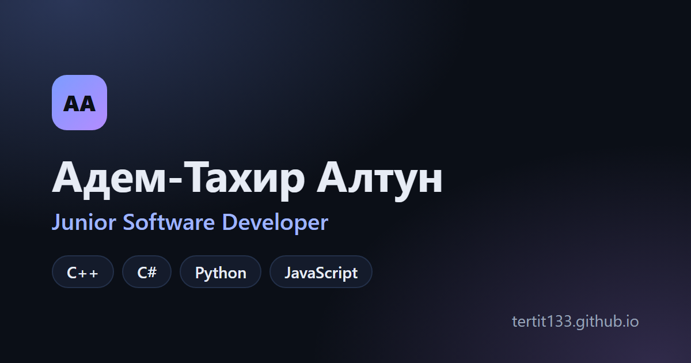

# tertit133.github.io

Сайт-портфолио Адем-Тахира Алтуна: **https://tertit133.github.io**



Сделан на React и Vite, тёмная тема по умолчанию, адаптивная вёрстка. Публикуется на GitHub Pages автоматически через GitHub Actions при каждом push в `main`.

## Как поменять содержимое

| Что | Где |
|---|---|
| Имя, тексты, контакты, навыки, опыт, блок «Сотрудничество» | `src/data/profile.js` |
| Проекты | `src/data/projects.js`, картинки в `public/projects/` |
| Резюме на русском и английском | `public/resume.pdf` и `public/resume-en.pdf`: готовые PDF, для обновления достаточно заменить файл |
| Картинка-превью ссылки, иконка для iOS | `assets-src/og-image.html`, `assets-src/icon.html` |

После правки этих HTML-файлов картинки пересобирает команда (нужен Microsoft Edge):

```powershell
powershell -ExecutionPolicy Bypass -File assets-src\build-assets.ps1
```

## Локальный запуск

```bash
npm install
npm run dev
```
